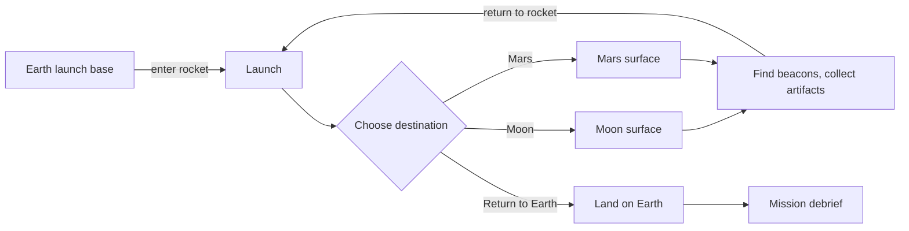

<div align="center">

# Abandoned but Not Forgotten

**A 3D exploration game about the hardware NASA left behind on the Moon and Mars**

Team AstroCore · NASA Space Apps Challenge 2026


[Play](#live-demo) · [How it works](#how-the-game-works) · [Data](#the-nasa-data) · [Sources](#sources) · [Process](#our-process)

</div>

---

## Contents

- [The challenge](#the-challenge)
- [Project summary](#project-summary)
- [Live demo](#live-demo)
- [How the game works](#how-the-game-works)
- [Controls](#controls)
- [The NASA data](#the-nasa-data)
- [Artifact catalog](#artifact-catalog)
- [Sources](#sources)
- [Technical overview](#technical-overview)
- [Running it locally](#running-it-locally)
- [Our process](#our-process)
- [AI usage disclosure](#ai-usage-disclosure)
- [Limitations and future work](#limitations-and-future-work)
- [Team](#team)
- [Acknowledgements](#acknowledgements)

---

## The challenge

We worked on this challenge from the 2026 NASA Space Apps Challenge:

> **Abandoned but not Forgotten: Storytelling about NASA's Discarded Equipment on the Moon and Mars**

Decades of missions have left landers, rovers, descent stages and even a helicopter on the surfaces of the Moon and Mars. Most people never learn what happened to them after the launch headlines faded. The challenge asks teams to tell those stories in an engaging, educational way.

Official page: [spaceappschallenge.org](https://www.spaceappschallenge.org/2026/challenges/abandoned-but-not-forgotten-storytelling-about-nasas-discarded-equipment-on-the-moon-and-mars/)

---

## Project summary

Instead of a report or a slideshow, we turned the story into something you play.

You are a researcher on a data-collection expedition. You launch from Earth, land on the Moon, find real NASA hardware, land on Mars and do the same, then fly home and submit a mission report. If your report matches what you collected, the mission succeeds.

| | |
|---|---|
| Genre | First-person 3D exploration with an educational quiz |
| Setting | Earth launch base, the Moon, Mars |
| Goal | Recover all 25 artifacts, then pass the debrief |
| Data | Official NASA records only |
| Runs on | Any modern browser, desktop or phone, no install |
| Built with | One HTML file, Three.js, two JSON data files |

---

## Live demo

| | |
|---|---|
| Play online | [marufkhanop.github.io/astro-web](https://marufkhanop.github.io/astro-web/) |
| Source code | [github.com/marufkhanop/astro-web](https://github.com/marufkhanop/astro-web) |

> [!NOTE]
> The game loads `moon.json` and `mars.json` when it starts, so it must be served from a web address such as GitHub Pages. Double-clicking `index.html` will not work. See [Running it locally](#running-it-locally).

---

## How the game works

### The mission loop



### Step by step

1. **Start at the launch base.** You spawn on Earth next to the rocket, surrounded by a launch complex.
2. **Launch.** Walk to the rocket and interact. A countdown plays and you lift off into deep space.
3. **Pick a world.** The Moon and Mars float in front of you. Click or tap one to travel there.
4. **Find the artifacts.** Each one is marked by a tall yellow beacon. A compass in the HUD points to the nearest one and shows the distance and how many remain on that world.
5. **Collect.** Get close and interact. A NASA data card opens with the mission year, what it did, why it was left behind, its coordinates, and links to the official sources.
6. **Watch your oxygen.** O₂ drains while you are away from the rocket and refills when you are near it. At zero you are recalled to the rocket with a full tank.
7. **Switch worlds as often as you like.** Return to space and pick the other destination.
8. **Go home.** Once you have at least one artifact, you can return to Earth and start the debrief.

### The debrief

On landing back on Earth you submit a mission report.

| Requirement | Detail |
|---|---|
| Item count | Enter how many artifacts you collected (the inventory shows it) |
| Questions | Up to four, each picked at random from artifacts you collected |
| Wrong answer | You get a message and can retry after reviewing your inventory |
| Full win | All answers correct **and** all 25 artifacts collected |
| Partial result | Correct answers but fewer than 25 artifacts shows "Game Over (for now)" with your count |

The quiz only covers what you collected, so a player who actually read the cards can pass and one who rushed cannot.

### The three worlds

| World | Gravity (game units) | Sky | Terrain |
|---|---|---|---|
| Earth | 26 | Blue, fog, clouds | Green hills, trees, flowers |
| Moon | 3.2 | Black, stars, distant Earth | Grey, craters, floaty jumps |
| Mars | 9 | Orange-brown haze | Rust red, rocky mesas |

---

## Controls

### Desktop

| Input | Action |
|---|---|
| `W` `A` `S` `D` | Move |
| `↑` `↓` `←` `→` | Move and turn |
| Mouse | Look (click once to lock the cursor) |
| `Space` | Jump |
| `Shift` | Sprint |
| `E`, click or right-click | Interact |
| `I` | Inventory |
| `H` | Show or hide the controls hint |
| `Esc` | Release the mouse |

### Mobile

| Input | Action |
|---|---|
| Left stick | Move |
| Drag on screen | Look |
| Up-arrow button | Jump |
| Hand button | Interact |
| Bag button (top left) | Inventory |

The mode is detected automatically. If it picks wrong, open **Settings** (gear button, top center) and choose **Auto**, **PC** or **Mobile**. The choice is remembered.

---

## The NASA data

All facts in the game come from two files:

| File | Artifacts |
|---|---|
| [`moon.json`](./moon.json) | 17 |
| [`mars.json`](./mars.json) | 8 |

There are no fallback facts in the game code. If the files fail to load, the game shows an error and does not start, so nothing unverified can appear.

### Record format

```json
{
  "name": "Surveyor 3",
  "type": "lander",
  "latitude": -3.0162,
  "longitude": -23.418,
  "year": 1967,
  "description": "Dug the soil with a scoop. Apollo 12 astronauts later visited it...",
  "fate": "Its work was done; the rest stayed in the Ocean of Storms.",
  "key_fact": "Apollo 12 astronauts brought back its parts",
  "short_description": "Robotic lander with a scoop, later visited by Apollo 12.",
  "data_provider": "NASA NSSDCA (NASA Goddard Space Flight Center)",
  "nasa_verified": true,
  "sources": ["https://nssdc.gsfc.nasa.gov/planetary/lunar/lunar_artifact_impacts.html"],
  "quiz": [
    {
      "question": "Which crew visited Surveyor 3 and brought home pieces of it?",
      "answer": "Apollo 12",
      "wrong_answers": ["Apollo 11", "Apollo 14", "Apollo 17"]
    }
  ]
}
```

| Field | Used for |
|---|---|
| `latitude`, `longitude` | Placing the artifact on the in-game map |
| `year`, `description`, `fate` | The info card shown on collection |
| `key_fact` | The highlighted "Remember" line |
| `short_description` | The italic summary under the title |
| `data_provider`, `nasa_verified`, `sources` | The verification badge and source links |
| `quiz` | Debrief questions |
| `note` | Extra honesty notes, such as shared coordinates |
| `image_url`, `image_credit` | Optional photo on the card (supported, currently empty) |

### How artifacts are placed

Positions are based on real coordinates, not random scatter.

1. Each world has a reference point: the Apollo 11 descent stage on the Moon and Viking 1 on Mars.
2. Every artifact's offset from that point is calculated from its latitude and longitude.
3. The whole layout is scaled to fit the playable area.
4. A spreading pass separates artifacts that would overlap (for example Apollo 15 and its rover share a site) and keeps everything clear of the rocket.

The relative arrangement stays true to reality: Surveyor 3 sits near Apollo 12, Surveyor 7 is far south near Tycho, and Odysseus and Athena are near the south pole.

> [!IMPORTANT]
> **Coordinate systems.** Moon: Mean Earth/Polar Axis (DE421), planetocentric. Mars: planetocentric. Latitude is N+, longitude is E+, range −180 to 180. NASA longitudes given as 0 to 360 were converted.

> [!NOTE]
> **Data notes.** NASA does not list separate coordinates for the three Apollo rovers, so each uses the coordinates of its Lunar Module landing site, and the card says so. Ingenuity uses the Mars 2020 landing site (Octavia E. Butler Landing, Jezero Crater, accurate to about 600 m), because its first airfield was right beside it.

---

## Artifact catalog

### Moon (17)

| # | Artifact | Type | Year | Why it matters |
|---|---|---|---|---|
| 1 | Surveyor 1 | Lander | 1966 | First US soft landing on the Moon |
| 2 | Surveyor 3 | Lander | 1967 | Dug soil with a scoop; Apollo 12 brought parts home |
| 3 | Surveyor 5 | Lander | 1967 | First chemical analysis of lunar soil |
| 4 | Surveyor 6 | Lander | 1967 | First liftoff from the Moon (a short hop) |
| 5 | Surveyor 7 | Lander | 1968 | Last Surveyor, landed in the Tycho highlands |
| 6 | Apollo 11 Descent Stage | Descent stage | 1969 | Tranquility Base, first crewed landing |
| 7 | Apollo 12 Descent Stage | Descent stage | 1969 | Landed within walking distance of Surveyor 3 |
| 8 | Apollo 14 Descent Stage | Descent stage | 1971 | Fra Mauro; the crew pulled a hand cart |
| 9 | Apollo 15 Descent Stage | Descent stage | 1971 | First landing with a Lunar Rover, at Hadley Rille |
| 10 | Apollo 16 Descent Stage | Descent stage | 1972 | First landing in the lunar highlands |
| 11 | Apollo 17 Descent Stage | Descent stage | 1972 | Last crewed Moon landing |
| 12 | Apollo 15 Lunar Rover | Rover | 1971 | First Lunar Roving Vehicle driven on the Moon |
| 13 | Apollo 16 Lunar Rover | Rover | 1972 | Driven in the Descartes Highlands |
| 14 | Apollo 17 Lunar Rover | Rover | 1972 | Last rover driven by astronauts |
| 15 | Odysseus (IM-1) | Lander | 2024 | First US soft landing since Apollo (commercial) |
| 16 | Athena (IM-2) | Lander | 2025 | Landed on its side near the south pole |
| 17 | Blue Ghost Mission 1 | Lander | 2025 | Operated upright for a full lunar day |

### Mars (8)

| # | Artifact | Type | Year | Why it matters |
|---|---|---|---|---|
| 18 | Viking 1 | Lander | 1976 | First successful US Mars landing |
| 19 | Viking 2 | Lander | 1976 | Studied weather and soil in Utopia Planitia |
| 20 | Pathfinder + Sojourner | Lander and rover | 1997 | First wheeled rover on Mars, airbag landing |
| 21 | Spirit | Rover | 2004 | Found evidence of past liquid water in Gusev Crater |
| 22 | Opportunity | Rover | 2004 | Worked nearly 15 years, found clay minerals |
| 23 | Phoenix | Lander | 2008 | Confirmed water ice below the arctic surface |
| 24 | InSight | Lander | 2018 | Recorded marsquakes |
| 25 | Ingenuity | Helicopter | 2021 | First powered flight on another planet, 72 flights |

Every artifact has its own 3D model built from simple shapes (cylinders, boxes, cones), which keeps the game light enough for phones.

---

## Sources

Everything in the game was taken from official NASA pages.

### Moon

| Source | Used for |
|---|---|
| [NSSDCA: Lunar Artifacts and Impact Sites](https://nssdc.gsfc.nasa.gov/planetary/lunar/lunar_artifact_impacts.html) | Surveyor, Apollo, Odysseus, Athena and Blue Ghost records and coordinates |
| [NSSDCA: Lunar Landing Sites](https://nssdc.gsfc.nasa.gov/planetary/lunar/lunar_sites.html) | Apollo landing sites and mission context |
| [NSSDCA: Apollo Lunar Roving Vehicle](https://nssdc.gsfc.nasa.gov/planetary/lunar/apollo_lrv.html) | Rover facts |
| [NASA: LRO Images Intuitive Machines Odysseus Lander](https://www.nasa.gov/missions/lro/nasas-lro-images-intuitive-machines-odysseus-lander/) | Odysseus landing details |

### Mars

| Source | Used for |
|---|---|
| [NASA GISS Mars24: Mars Lander Missions](https://www.giss.nasa.gov/tools/mars24/help/landers.html) | Landing site coordinates for all Mars missions |
| [NSSDCA: Viking](https://nssdc.gsfc.nasa.gov/planetary/viking.html) | Viking 1 and 2 |
| [NASA Science: Mars Pathfinder](https://science.nasa.gov/mission/mars-pathfinder) | Pathfinder and Sojourner |
| [NASA ARES: Mars Exploration Rovers](https://ares.jsc.nasa.gov/missions/mer/) | Spirit and Opportunity |
| [NASA Space Place: Spirit and Opportunity](https://spaceplace.nasa.gov/mars-spirit-opportunity/) | Spirit and Opportunity (simple summary) |
| [NASA Science: Phoenix](https://science.nasa.gov/mission/phoenix) | Phoenix |
| [NASA Science: InSight's Landing Site in Elysium Planitia](https://science.nasa.gov/resource/insights-landing-site-elysium-planitia/) | InSight |
| [NASA Science: Ingenuity](https://science.nasa.gov/?p=326193) | Ingenuity |

<details>
<summary>Plain list of all 12 source URLs</summary>

```text
https://www.giss.nasa.gov/tools/mars24/help/landers.html
https://nssdc.gsfc.nasa.gov/planetary/viking.html
https://science.nasa.gov/mission/mars-pathfinder
https://ares.jsc.nasa.gov/missions/mer/
https://spaceplace.nasa.gov/mars-spirit-opportunity/
https://science.nasa.gov/mission/phoenix
https://science.nasa.gov/resource/insights-landing-site-elysium-planitia/
https://science.nasa.gov/?p=326193
https://nssdc.gsfc.nasa.gov/planetary/lunar/lunar_artifact_impacts.html
https://nssdc.gsfc.nasa.gov/planetary/lunar/lunar_sites.html
https://nssdc.gsfc.nasa.gov/planetary/lunar/apollo_lrv.html
https://www.nasa.gov/missions/lro/nasas-lro-images-intuitive-machines-odysseus-lander/
```

</details>

**Data providers credited in the game**

- NASA NSSDCA (NASA Goddard Space Flight Center) for the Moon records
- NASA Goddard Institute for Space Studies, Mars24 Sunclock, for the Mars records

Every in-game card shows a "✔ NASA verified" badge, the provider, the coordinates, and clickable links to the sources for that item.

---

## Technical overview

### File structure

```text
.
├── index.html            the whole game: HTML, CSS, JavaScript
├── moon.json             Moon artifact data
├── mars.json             Mars artifact data
├── three.min.js          optional local copy of Three.js (offline fallback)
└── assets/
    └── nasa-insignia.png optional, shown on the rocket and building if present
```

### Stack

| Layer | Choice | Reason |
|---|---|---|
| Rendering | [Three.js](https://threejs.org/) r128 | Runs everywhere, no build step |
| Language | Vanilla JavaScript | Keeps everything in one portable file |
| Styling | Hand-written CSS, glass-style panels | Readable HUD over a bright 3D scene |
| Data | Two static JSON files | Easy to check against NASA pages |
| Audio | Web Audio API | Countdown, beeps and rumble without audio files |
| Hosting | Any static host | GitHub Pages works |

### Implementation notes

- **Library loading.** Three.js loads from cdnjs first, then jsDelivr, then a local `three.min.js`, so the game still starts if one source is down.
- **Terrain.** An 80 by 80 grid drawn as a single `InstancedMesh`, with a different height map per world and crater carving on the Moon.
- **Models.** Every spacecraft is built in code from primitives, with solar panels, legs, antennas, nameplates and landing scars. Apollo sites also get flags, ALSEP instruments and rovers where historically accurate.
- **Movement.** Height-based collision against the terrain grid, plus bounding boxes for Earth base buildings.
- **Oxygen.** Drains at about 0.9 per second away from the rocket and refills near it.
- **Performance.** Shadows are only re-rendered when something changes, which keeps frame rate usable on phones.
- **Responsive UI.** Layout uses `clamp()` and safe-area insets so controls fit notched phones and landscape mode.
- **Safe rendering.** Text from the JSON files is escaped before display, and image and link URLs are checked before use.

---

## Running it locally

The game fetches its JSON files, so it needs a local web server.

```bash
git clone https://github.com/marufkhanop/astro-web.git
cd astro-web

# pick one
python3 -m http.server 8000
npx serve .
```

Open `http://localhost:8000`.

**Publishing on GitHub Pages:** push `index.html`, `moon.json` and `mars.json`, then go to Settings, then Pages, and choose your branch and root folder.

> [!WARNING]
> `moon.json` and `mars.json` must be in the same folder as `index.html`. If either is missing, the game shows an error and does not start. This is intentional.

---

## Our process

The challenge rules ask teams to document how the project was made. This section is that record.

### 1. Initial plan

Before using any AI tool, we mapped out the minimum we wanted to build.

| Area | Plan |
|---|---|
| Core loop | Keep it simple: start at an Earth launch base, walk to a rocket, launch into space, pick the Moon or Mars, land, and walk around a 3D surface to find and collect historical NASA hardware |
| Tech stack | Stay lightweight: vanilla JavaScript, HTML5 and Three.js loaded from a CDN, with no heavy build tools |
| Data | Keep all artifact data (coordinates, descriptions, quiz questions, image URLs) in JSON files, `moon.json` and `mars.json`, so the code stays separate from the content |
| Controls and UI | Support PC (WASD and mouse look) and mobile (on-screen joystick and touch drag), with a glass-style sci-fi HUD built in plain CSS |

The concept we settled on: the player is a researcher who physically visits each world, finds the equipment, and has to prove they learned something.

### 2. Design decisions

| Decision | Reasoning |
|---|---|
| A game, not a report | Players discover the facts instead of only reading them |
| Both the Moon and Mars | The challenge covers both, and the worlds feel different (gravity, sky, terrain) |
| Return to Earth to submit a report | Gives the trip a start and a finish |
| Quiz only on collected items | The questions match what the player actually read |
| Real coordinates for placement | The in-game map follows the real layout |
| One HTML file and two JSON files | Content stays separate from code and is easy to check |
| Desktop and mobile controls | The game plays on both |
| No fallback facts in code | All content has to come from the data files |

### 3. Research and data collection

1. Found the official NASA page for each artifact and recorded its year, purpose, fate and coordinates.
2. Converted NASA's 0 to 360 longitudes to the −180 to 180 range.
3. Wrote the `key_fact`, `short_description` and quiz questions in simple language based on those pages.
4. Stored the source URLs on every record.
5. Where NASA gave no separate coordinates (the three Apollo rovers), reused the landing site and added a note.

The full list of pages is in [Sources](#sources).

### 4. Building with AI

We split the work between two tools:

1. **ChatGPT** as a sounding board. We described the game and asked it to help structure a detailed prompt covering the architecture, edge cases and the math (coordinate mapping, raycasting), so the code prompt would be solid and Claude would not have to guess.
2. **Claude** to write the code. We chose it because it handles large, complete code blocks well. We gave it the structured prompt and it produced the game as a single `index.html`.

The prompts are in the [prompt log](#prompt-log).

### 5. Build progress

- [x] Earth launch base, rocket and walking controls
- [x] Launch sequence and space scene with selectable Moon and Mars
- [x] Terrain, gravity, sky and fog per world
- [x] Collectible beacons and the info card
- [x] Inventory screen
- [x] Oxygen system
- [x] Loading real data from `moon.json` and `mars.json`
- [x] Coordinate-based placement
- [x] A 3D model for every artifact
- [x] Landing and return to Earth
- [x] Debrief quiz and ending screens
- [x] Mobile controls
- [x] Settings panel with control mode switch
- [x] UI refresh and responsive layout
- [x] Verification badge, coordinates and source links on cards
- [ ] Real photos on info cards (layout ready, images not added)
- [ ] Sound polish

### 6. Problems we ran into

We opened the game in the browser several times while building it, and two problems stood out.

| Problem | What happened | How we fixed it |
|---|---|---|
| Reversed controls | Movement and looking worked in the wrong direction | Corrected the control mapping and checked it again in the browser |
| Heavy lag | The game ran slowly, especially with a large world | Limited the size of the explorable area and optimized rendering. The current build uses a fixed 160 by 160 unit play area, draws the terrain as a single instanced mesh, only refreshes shadows when something changes, and keeps the 3D models to simple shapes |

---

## AI usage disclosure

The Space Apps rules ask for openness about AI use, so here it is.

| Tool | Used for |
|---|---|
| ChatGPT | Helping us write clear, well-structured prompts |
| Claude | Writing the game code and drafting this README |

All facts, dates and coordinates come from the NASA pages listed in [Sources](#sources), and the team checked them against those pages.

### Prompt log

<details>
<summary>Prompt 1: ChatGPT, building a prompt for the game engine</summary>

```text
"Yo, I'm building a browser-based 3D exploration game using Three.js where players collect NASA artifacts on procedural Moon and Mars terrains. I need to write a killer prompt for Claude that will generate the core game engine script. Help me structure a prompt that covers:

- Setting up a responsive Three.js scene with lighting, fog, and skyboxes that change per planet (Earth, Moon, Mars).
- A first-person player controller that handles collision detection with terrain heightmaps and custom bounding boxes.
- Dynamic loading of external JSON data (moon.json and mars.json) to place 3D low-poly models of landers and rovers based on real latitude/longitude scaling.
- A state machine handling transitions from Hub -> Launch Animation -> Space Selection -> Planet Surface -> Quiz Debrief.

Give me the exact prompt I should copy-paste into Claude to get this built cleanly in one go."
```

Result: ChatGPT gave us a structured prompt, which we used as the base for the Claude prompt below.

</details>

<details>
<summary>Prompt 2: Claude, writing the game</summary>

```text
"Act as an expert frontend graphics engineer. Write a complete, self-contained single-page web app (index.html) using Three.js (r128) via CDN that implements a 3D space exploration game called 'Abandoned but Not Forgotten'.

Here are the exact requirements:

- Engine & Renderer: Vanilla JS, WebGLRenderer with optimized pixel ratio, shadow maps enabled, window resize listener, and error handling for missing CDNs.
- Game States: Handle 5 distinct states: TITLE/HUB, LAUNCH (smooth rocket lift-off animation with particle exhaust), SPACE (interactive orbital view to click/select Moon or Mars), LAND (descent sequence), and SURF (surface exploration).
- Terrain & Environment: Generate procedural heightmap terrains using an InstancedMesh for performance. Different atmospheric fog, gravity, and sky colors for Earth, Moon, and Mars.
- NASA Data Integration: Fetch moon.json and mars.json. Dynamically convert real planetary coordinates (lat/long) into local 3D world space positions using a scaling and collision-avoidance spacing algorithm.
- Procedural 3D Models: Write procedural generation functions for complex hardware (Viking landers, Apollo descent stages, Lunar Rovers, Ingenuity helicopter, SpaceX/commercial landers) using basic Three.js geometries combined neatly into groups.
- UI & Controls: Build a glassmorphism CSS HUD overlay (#hud, inventory modal, settings menu). Implement dual control schemes: PC mode (WASD + PointerLock mouse look) and Mobile mode (virtual touch joystick on the left, drag-to-look, and action buttons). Include an O2 countdown timer mechanic on alien surfaces that teleports the player back if depleted."
```

Result: Claude produced the working `index.html`, which we then tested and adjusted (see [Problems we ran into](#6-problems-we-ran-into)).

</details>

---

## Limitations and future work

**Limitations**

- Models are simplified shapes, not replicas of the real hardware.
- Terrain is stylized, not built from real elevation data.
- Mars covers eight missions; hardware from failed missions is not included.
- The photo slot on info cards is empty for now.
- Map distances are scaled and nudged apart, so they are proportional, not exact.

**Ideas for next time**

- Add real NASA images and LRO or HiRISE orbital views to each card.
- Add deep-space hardware such as the Voyagers.
- Use real terrain data from Moon Trek and Mars Trek for the landing areas.
- Add a teacher mode with printable fact sheets.
- Add more languages.

---

## Team

**Team AstroCore**

| Name | Role |
|---|---|
| Maruf Khan | UI/UX designer |
| Omar Faruk Fahad | Developer |
| Musrika Nur Tayiha | Narrator |
| Atikul Islam Joy | Researcher, developer |
| Morad Ebn Hafiz | Video editor, team leader |

---

## Acknowledgements

- NASA, and the teams behind NSSDCA, GISS Mars24, NASA Science, ARES and NASA Space Place, for the public data this project is built on.
- The NASA Space Apps Challenge organizers and local event hosts.
- [Three.js](https://threejs.org/) and its contributors.

> NASA does not endorse this project. All mission data belongs to NASA and its partners. This is an independent educational project made for the Space Apps hackathon.

<div align="center">

*Abandoned, but not forgotten.*

</div>
